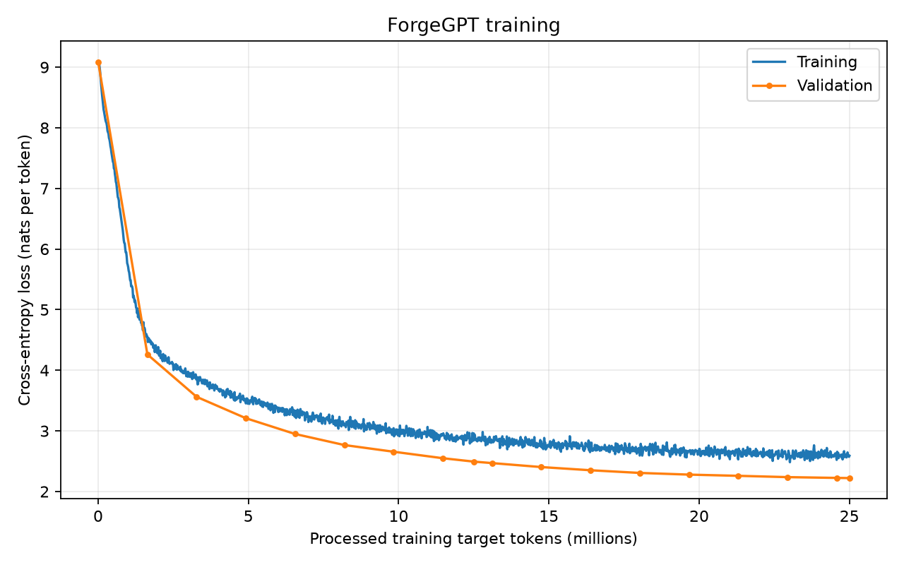

# StoryForge

StoryForge is a Python project for developing small decoder-only transformer
language models from scratch on TinyStories, with a focus on configurable
experiments, text generation, and GPU performance optimization.

## Implemented

- Installable Python package with a `src/` layout.
- TinyStories preparation, duplicate filtering, and byte-level BPE tokenization.
- Packed token streams and configurable next-token batch sampling.
- ForgeGPT with causal multi-head attention, pre-norm blocks, and tied embeddings.
- AdamW training with gradient accumulation, learning-rate scheduling, validation,
  checkpointing, and loss logging.
- Seeded text generation and training-curve visualization.

## Baseline results

The 13.89M-parameter model was trained from scratch on TinyStories using Apple
Silicon MPS in float32.

| Metric | Result |
|---|---:|
| Processed training target tokens | 25,001,984 |
| Best validation loss | 2.2216 |
| Validation perplexity | 9.2217 |
| Training time, excluding evaluation and checkpointing | 12 min 55.60 s |
| Training throughput | 32,236 target tokens/s |
| Peak GPU memory | Not measured on MPS |



See the [experiment report](results/baseline/README.md) for training settings,
the evaluation scope, and continuations from all three checkpoints.

## Setup

Use Python 3.11 and create a fresh environment:

```bash
python3.11 -m venv .venv
source .venv/bin/activate
python -m pip install -r requirements.txt
python -m pip install -e .
```

Open `notebooks/00_playground.ipynb` in VS Code and select `.venv` as the
notebook kernel.
