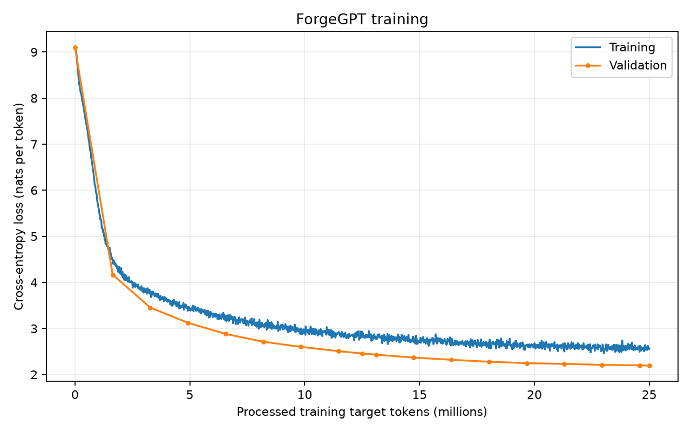

# Story-boundary masking experiment

ForgeGPT trained from the same untrained checkpoint as the [baseline](../baseline/README.md),
using the same tokenizer, token streams, architecture dimensions, optimizer settings,
and approximately 25-million-target-token budget. Attention additionally blocks
connections across EOS-delimited stories. The EOS token belongs to the story it ends.
Learned positions are not reset at story boundaries; the target stream and loss remain
unchanged, including EOS-to-next-story predictions.

## Results

| Measurement | Result |
|---|---:|
| Processed training targets | 25,001,984 |
| Optimizer updates | 1,526 |
| Initial validation loss | 9.102877 |
| Best validation loss | 2.195103 |
| Validation perplexity | 8.980927 |
| Best checkpoint update | 1,526 |
| Training time | 855.83 s |
| Wall time excluding initial validation | 875.79 s |
| Training throughput | 29,213.63 target tokens/s |
| Device / precision | Apple Silicon MPS / float32 |

Validation evaluates the same fixed prefix of 32,768 target tokens as the baseline,
but uses story-boundary masking. The baseline's reported loss uses ordinary causal
attention. These scores therefore compare the two complete configurations; they do
not isolate the effect of training under different masks from differences in
validation context. No common-mask evaluation is included in these results.

## Memory measurement

- Maximum observed tensor allocation: **1.087 GiB**.
- Maximum observed Metal driver allocation: **2.113 GiB**.
- Samples: **71,683**.
- Requested sampling interval: **10 ms**.
- Scope: the full main training loop, including periodic validation and generation;
  initial setup is excluded.

These are sampled maxima; brief spikes may be missed. Driver allocation includes
cached and framework allocations as well as live tensor storage. The baseline
memory probe covered only ten training updates, so its figures have a different
scope. Background sampling introduces overhead and was not enabled during the
baseline full run, which also limits throughput comparisons.

## Generation

The same three cat prompts, temperature 0.8, top-k 50, maximum 150 new tokens, and
prompt-specific seeds 100, 101, and 102 are used across checkpoints. Full outputs
and settings are stored in [samples.json](samples.json).

| Stage | Processed training targets | Outputs |
|---|---:|---:|
| Initial | 0 | 3 |
| Halfway | 12,500,992 | 3 |
| Final | 25,001,984 | 3 |

## Saved measurements

- [summary.json](summary.json): training and validation summary, including memory measurements.
- [metrics.jsonl](metrics.jsonl): all 1,527 measurements, including step zero.
- [memory_profile.json](memory_profile.json): full-run MPS sampling results and scope.
- [samples.json](samples.json): all nine generated outputs.
- [loss_curves.png](loss_curves.png): losses versus processed training target tokens.

Model checkpoints remain outside Git. This result uses [story_masked.toml](../../configs/story_masked.toml).
