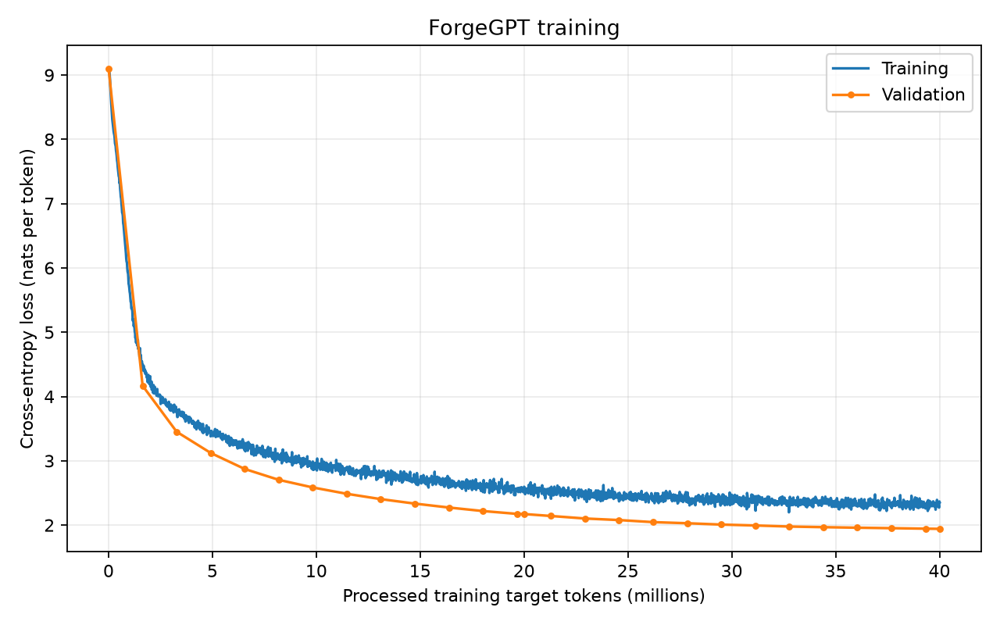

# Story-masked ForgeGPT: 40M-target experiment

A fresh six-block ForgeGPT run using the same untrained checkpoint, tokenizer,
packed token streams, and story-boundary masking as the [25M masked run](../story_masked/README.md).
This experiment increases the configured training budget from 25M to 40M target
tokens. It does not continue training the completed 25M checkpoint.

## Results

| Measurement | 25M run | 40M run |
|---|---:|---:|
| Processed training targets | 25,001,984 | 40,009,728 |
| Optimizer updates | 1,526 | 2,442 |
| Best validation loss | 2.195103 | 1.941625 |
| Validation perplexity | 8.980927 | 6.970070 |
| Training time | 855.83 s | 1380.23 s |
| Training throughput | 29,213.63 targets/s | 28,987.68 targets/s |

The best checkpoint occurs at update 2,442, after
40,009,728 processed targets. Initial validation loss is
9.102877. Wall time excluding initial validation is
1404.83 seconds. Training uses
Apple Silicon MPS with float32 parameters.

## Controls and interpretation

Both runs have 13,891,584 parameters, six blocks, width 384, six heads, learned
positions, context 256, and dropout 0.1. Both start with identical saved weights
and produce identical recorded initial samples. Validation uses the same fixed
32,768 target-token prefix and story-boundary masking in both runs.

Each update processes eight microbatches of eight sequences with 256 targets
per sequence: 16,384 targets per update. AdamW uses peak learning rate 0.0003,
minimum learning rate 0.00003, betas (0.9, 0.95), matrix weight decay 0.1,
gradient norm clipping at 1.0, and 100 warmup updates. Training loss is measured
with dropout enabled; validation disables dropout.

The longer run has lower measured validation loss and perplexity. The cosine
schedule depends on the total update count, so it decays over 2,442 rather than
1,526 updates. This is a training-budget-and-schedule comparison, not the original
25M trajectory followed by another 15M tokens. These single-run results do not
estimate variation across random seeds.

## Memory

| Sampled measurement | 40M run |
|---|---:|
| Maximum observed tensor allocation | 1.031 GiB |
| Maximum observed Metal driver allocation | 2.113 GiB |
| Number of readings | 114,074 |
| Requested interval | 10 ms |

Monitoring covers the main training loop, including periodic validation and
sample generation, excluding initial setup. Driver allocation includes caches
and framework allocations. Sampling can miss brief peaks, so these values are
observed maxima rather than exact allocator peaks. The lower tensor reading
than the 25M run is not evidence that longer training requires less peak memory.
Both runs include monitoring overhead in their timing measurements.

## Generated samples

The three cat prompts, temperature 0.8, top-k 50, maximum 150 new tokens, and
prompt-specific seeds 100, 101, and 102 are unchanged. Initial, halfway, and final
outputs are saved at 0, 20,004,864, and 40,009,728 processed targets, respectively.

Final samples exhibit sentences, paragraphs, dialogue, and story-ending patterns,
but retain entity drift, contradictions, repetition, and grammatical errors.
For example, the spaceship continuation shifts from Luna to Lily and Ella, while
the mother agrees to an adventure and is immediately contradicted. The
world-domination prompt shifts among unrelated animals and people. Lower
validation loss has not solved long-range narrative consistency.

Full outputs are preserved in [samples.json](samples.json).

## Saved measurements

- [summary.json](summary.json): final metrics and embedded memory results.
- [metrics.jsonl](metrics.jsonl): all 2,443 records, including the initial measurement.
- [memory_profile.json](memory_profile.json): memory sampling results and scope.
- [samples.json](samples.json): all nine outputs and generation settings.
- [loss_curves.png](loss_curves.png): training and validation curves.
- [Run configuration](../../configs/story_masked_40m.toml).

Model checkpoints remain outside Git.
